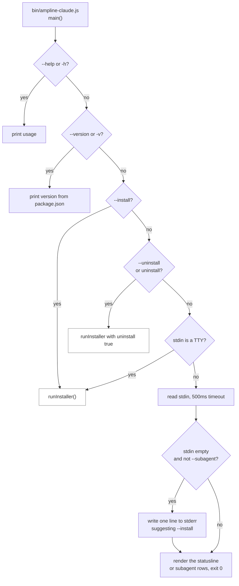
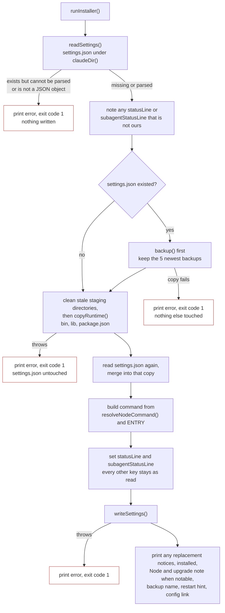
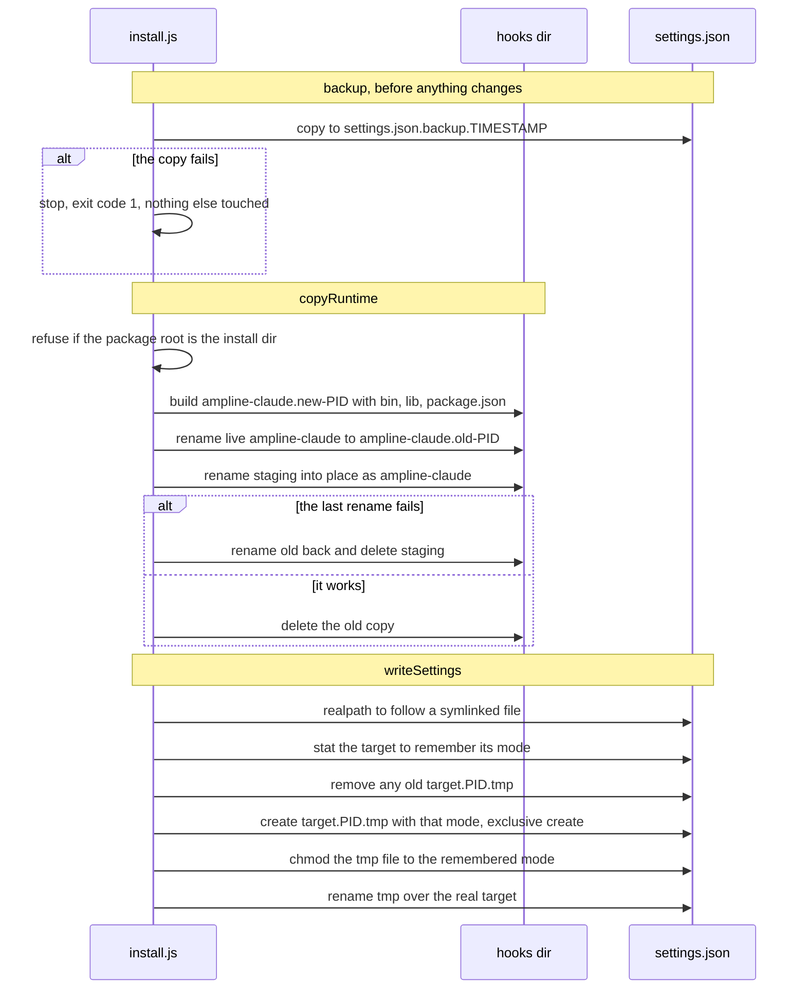
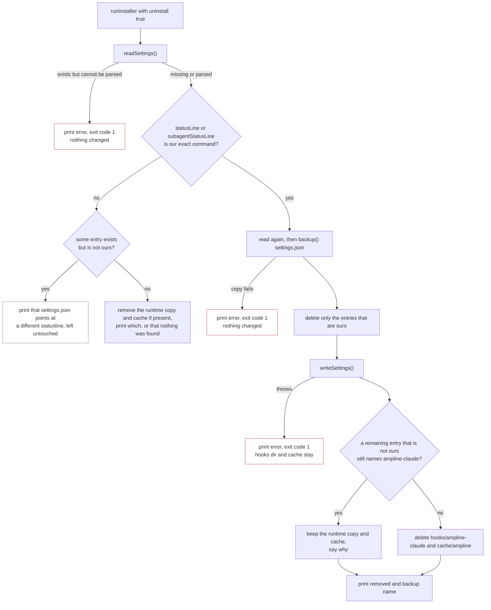

# Flowchart: install and uninstall

What `npx ampline-claude --install` and `npx ampline-claude uninstall` do to the machine, and how
the entry point decides to run the installer at all. The installer is the one module that edits a
file the user owns, so most of the steps below exist to avoid damaging it. For where the installed
copy runs, see [`render-sequence.md`](render-sequence.md). For the trust boundaries, see
[`deployment-security.md`](deployment-security.md).

## How the entry point picks a path

Flags are checked before the TTY test, so `--install` and `uninstall` work from scripts and CI.
A bare `npx ampline-claude` installs only when stdin is a TTY. Claude Code runs the same entry
point with piped stdin on every render, so a non-TTY invocation cannot be told apart from a real
render. If stdin turns out to be empty, the entry point still runs the render path and exits 0,
and it writes the one-line hint to stderr only. It never touches stdout. This is `DECISIONS.md`
D17, and D9 explains why there is no interactive menu. The `if (require.main === module)` guard
at the bottom keeps a plain `require('ampline-claude')` from starting an install.

## Install

**What gets written.** `statusLine` is `{ type: "command", command, padding: 0, refreshInterval: 30 }`
and `subagentStatusLine` is `{ type: "command", command: "<same command> --subagent" }`. The
command is the node binary in quotes followed by the quoted path to
`<claudeDir>/hooks/ampline-claude/bin/ampline-claude.js`. Both paths use forward slashes, which
Windows accepts and which avoids escaping backslashes in JSON.

**Which node.** `resolveNodeCommand()` asks `chooseNodePath()`. It starts from `process.execPath`
(absolute and an existing file, or the command falls back to a bare `node`, `DECISIONS.md` D27).
When that path is in a version-manager directory (Homebrew `Cellar`, nvm, fnm, volta, asdf,
nodenv, mise, a snap revision), which disappears on an upgrade, it prefers a stable `PATH` entry
that resolves to the same file, then the real file behind a link, and otherwise keeps
`execPath` (`DECISIONS.md` D44). Only in that case, or for the bare `node` fallback, does the
install print the path it wrote and a reminder to re-run `--install` after upgrading Node; a
normal install prints the same six lines as v0.6.0. `refreshInterval: 30` is there because the
reset countdown and git state go stale while Claude Code is idle (`DECISIONS.md` D33).

**Which commands are ours.** An entry is ours only if its command is a node interpreter (bare,
or an absolute path to `node`, `nodejs`, or a versioned name such as `node24`, `node-24.1` or
`node-v24.1.0`, with an optional `.exe` and nothing else after the name) followed by the quoted
`<dir>/hooks/ampline-claude/bin/ampline-claude.js`, with or without `--subagent` (`pointsAtUs`).
The file name of the Node that is running the installer is accepted too, because that is what
install writes when nothing better is found, whatever it is called. A command that only mentions
the name, such as a user's `ampline-claude-wrap.sh`, or whose interpreter is a wrapper such as
`node2-wrapper.sh` or `node24.cmd`, is foreign.

**Foreign entries.** A `statusLine` or a `subagentStatusLine` that is not ours is replaced
after a notice that shows the old command, and the backup taken first holds it. Everything else in
`settings.json`, such as hooks, MCP servers and `env`, is kept because the merge only assigns those
two keys.

**Where it lives.** `CLAUDE_CONFIG_DIR` is honored through `lib/claudeDir.js`, which returns the
override resolved to an absolute path, or `~/.claude` when it is unset. The settings file, the
hooks directory, the backups and the cache directory all hang off that one value, so the
installer cannot report success while writing a `settings.json` that Claude Code never reads
(`DECISIONS.md` D24). The value is computed when `install.js` loads.

## The two risky file operations

**The backup comes first.** It is taken right after the first read, before the runtime copy, so
a failed backup stops the install with exit code 1 and leaves both `settings.json` and the
installed copy as they were. Backups are named `settings.json.backup.<timestamp>` and sit next to
the settings file. Only the newest five that match that exact name are pruned, so a copy you made
by hand is never touched (`DECISIONS.md` D44).

**The runtime copy is staged, then swapped.** The live install is never deleted before its
replacement exists. If the final rename fails, the previous directory is renamed back and the
error is rethrown, so a failed update leaves the old version in place (`DECISIONS.md` D13). The
installer also refuses to run from inside the installed copy, since removing a directory you are
running from fails with EBUSY on Windows. `package.json` is copied because `--version` reads it.
Staging directories left by a crashed install are removed once they are over a minute old and
their process is gone. The result is that Claude Code runs a stable local copy, not a fresh `npx`
download on every render.

**The settings write goes through symlinks and keeps permissions.** Dotfiles managers often
symlink `settings.json`, and a plain rename would replace the link with a regular file. Resolving
the real path first means the link survives. The temp file is created with the original mode, so
its contents are never readable by more people than before, even for an instant, and the chmod
restores any bits the umask masked, so a deliberate `chmod 600` on a file that can hold API keys
is not lost (`DECISIONS.md` D28). An old file at the temp name is removed, never written through.
Windows has no POSIX permission bits, so that part is verified only on POSIX machines.
`settings.json` is read again just before the write and the keys are merged into that copy, which
keeps a change Claude Code made in between, though the backup is of the first read.

## Uninstall

**Ownership is the exact command, not a substring.** The same `pointsAtUs` test as for install
decides. If one entry is ours and the other is foreign, uninstall removes the one that is ours and
leaves the foreign one in place. When neither is ours and one is foreign, nothing is touched at
all, not even the runtime copy, because a different statusline may call it.

**A wrapper keeps the runtime.** After our entries are removed, a remaining entry that is not ours
but still names `ampline-claude` (a wrapper script around the installed copy, say) may call the
installed copy, so the runtime copy and cache stay and the output says so. A foreign entry that
has nothing to do with ampline does not keep them.

**The backup comes after the decision.** `backup()` runs only once uninstall has decided to change
something, so a refused uninstall leaves no stray backup file, and a failed backup changes
nothing. The hooks directory and the cache directory are deleted only after `settings.json` has
been written successfully, so a failed write cannot leave Claude Code pointing at a runtime that no
longer exists. If `settings.json` has no ampline entries, or does not exist at all, uninstall still
removes the runtime copy and cache (unless a foreign entry remains, above) and says so. Old
`settings.json.backup.*` files are left alone.

---
_Last updated: 2026-10-26 · reflects v1.0.0_
